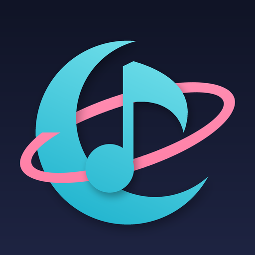

# ProjectCadence

An osu!-compatible rhythm game for jailbroken PS5s, running natively. It plays
osu!standard beatmaps, and the gameplay is a port of lazer's osu! ruleset, so timing
windows, slider ticks, stacking, scoring, health drain, star rating and pp match
lazer.

Plays osu!, taiko and mania maps. Maps and skins download on the console. There are local scores with pp, replays,
storyboards, search and sort in song select, and the main mods (EZ, NF, HT, HR, HD,
DT, Auto; DT and HT keep the music's pitch).

## What's where

- `core/` - C# gameplay: .osu decoder, slider paths, stacking, judging, lazer's
  standardised scoring, health. Ported from ppy/osu (MIT). NativeAOT compiles it
  and the result is linked straight into the eboot.
- `host/` - C side: Vulkan renderer on PS5_Vulkan's RADV, DualSense input, audio
  out, song select, pause, fail and results screens.
- `tests/check` - desktop autoplay check over a folder of maps:
  `dotnet run -c Release -- <maps dir>`
- `tools/` - build helpers, FTP deploy, a test map generator, klog helpers.

## Controls

Left stick aims like a tablet area (full tilt reaches the playfield edge), right
stick nudges. Touch the touchpad to aim with it, press it down to click.
R1 / R2 / Cross = K1, L1 / L2 / Square = K2. Options pauses, Triangle skips intros
and breaks.

Song select: the left stick scrolls through maps, d-pad up/down picks the
difficulty, Cross plays, Square opens mods, Triangle opens the map downloader,
L1 searches, R1 changes the sort, R2 watches your best replay on the difficulty,
L2 switches to the osu.ppy.sh leaderboard,
Options opens settings (volumes, offset, stick reach, background dim, cursor size,
storyboards), the touchpad opens the skin picker.

Everything lives in `/data/cadence` on the console; an older `/data/osu5` is moved
there on first launch.

## Maps

Triangle in song select searches [catboy.best](https://catboy.best), a public
mirror of osu.ppy.sh, and downloads ranked sets straight to the console. Or
extract .osz files (they're zips) into `/data/cadence/Songs/<folder>/` over FTP and
rescan from settings.

Star ratings use lazer's difficulty calculator, worked out on the console in the
background and cached in `/data/cadence/stars.txt`. Scores are kept per difficulty
in `/data/cadence/scores.txt`.

## Online leaderboards

Read only. Make an OAuth application on your osu! account settings page (any
callback URL), then put its client id and secret on two lines in
`/data/cadence/osuapi.txt`. L2 in song select shows the top scores.

## Skins

First launch asks for a skin. The picker can download osu!'s classic default
(straight from ppy/osu-resources, CC BY-NC 4.0), a few skins their authors
publish on GitHub, or any of the community skins listed by
[o!rdr](https://ordr.issou.best); nothing skin-related ships with this repo. Any other osu! skin
works too: unzip the .osk into `/data/cadence/skins/<name>/` and pick it from song
select with the touchpad. Circles, numbers, cursor, slider parts, spinner, hit
popups, score and combo digits, health bar, ranking letters, combo colours and
hitsounds come from the skin; slider bodies are drawn in the skin's colours.

## Building

Needs WSL (Ubuntu 24.04) and a jailbroken console with ShadowMountPlus.

```
tools/fetch-deps.sh          # PS5_Vulkan, RADV, SharpProspero
tools/setup-dotnet-wsl.sh    # .NET 10 + pwsh
./build.sh
PS5_IP=<console> tools/deploy.sh
```

The build ends up in `dist/PPSA70727`. Launch it from the home screen. Logs go to
`/data/cadence/cadence.log` on the console.

## Credits

- [ppy/osu](https://github.com/ppy/osu) - the gameplay this is ported from (MIT)
- [PS5_Vulkan](https://github.com/Mihawk-99/PS5_Vulkan) - RADV for PS5, toolchain,
  ELF converter and the clean-room libc.prx (GPL-3.0)
- [SharpProspero](https://github.com/SvenGDK/SharpProspero) - NativeAOT for PS5 (GPL-3.0)
- dr_mp3 / dr_wav, stb_vorbis / stb_image, font8x8 - see `NOTICE`

Not affiliated with ppy. osu! is a trademark of ppy Pty Ltd.

## License

GPL-3.0-or-later, see `LICENSE`. Code ported from osu! stays under its MIT notice
(`NOTICE`).
